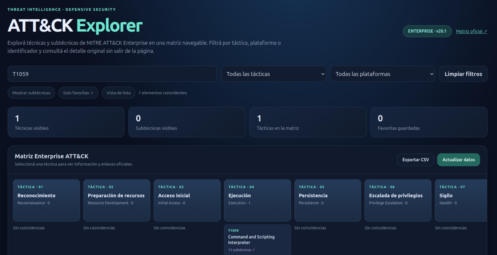
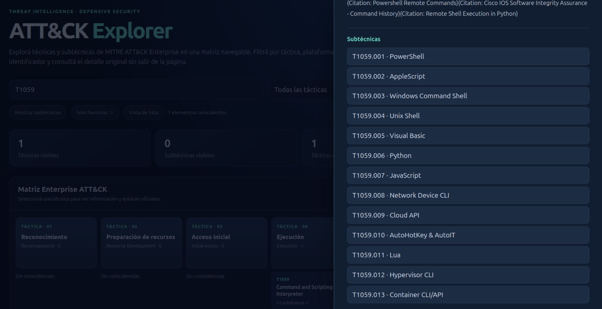

# Enterprise Threat Matrix Viewer

Explorador web **no oficial** de [MITRE ATT&CK® Enterprise](https://attack.mitre.org/matrices/enterprise/), diseñado para consultar tácticas, técnicas y subtécnicas de manera visual.

> Proyecto independiente de aprendizaje y visualización. No está afiliado, patrocinado ni respaldado por The MITRE Corporation.

## Capturas

**Búsqueda exacta de T1059**

**Subtécnicas de T1059 ordenadas por ID**

## Funcionalidades

- Matriz navegable de tácticas Enterprise ATT&CK.
- Búsqueda exacta por identificador (`T1059`, `T1059.001`, `T1110`).
- Búsqueda libre por texto y filtros por táctica y plataforma.
- Subtécnicas ordenadas por identificador MITRE.
- Panel de detalles con enlace a la ficha original.
- Favoritos almacenados localmente en el navegador.
- Exportación CSV de resultados filtrados.
- Vista de matriz y vista de lista.

## Probar localmente

Abrí `index.html` en Firefox o Chromium. La primera carga necesita Internet para obtener el dataset oficial; los datos se guardan en una caché local del navegador.

## Demo online

[**Abrir Enterprise Threat Matrix Viewer**](https://seezelop.github.io/enterprise-threat-matrix-viewer/)

La aplicación funciona directamente desde el navegador, sin instalación ni backend.

La primera carga requiere conexión a Internet para obtener los datos oficiales de MITRE ATT&CK.

## Datos y alcance

- Origen: [MITRE ATT&CK STIX Data](https://github.com/mitre-attack/attack-stix-data).
- Dataset fijado en el código: Enterprise ATT&CK v20.1 (`enterprise-attack-20.1.json`).
- Al cargar o actualizar se requiere conexión con `raw.githubusercontent.com`.
- Los textos descriptivos provienen del dataset y se muestran en inglés.
- El explorador no proporciona detección, correlación ni análisis automático de incidentes.

## Atribución y condiciones de uso

MITRE ATT&CK® es una marca registrada de The MITRE Corporation. Los datos de ATT&CK se utilizan bajo sus [condiciones de uso](https://attack.mitre.org/resources/terms-of-use/) y [directrices de marca](https://attack.mitre.org/resources/legal-and-branding/).

© 2026 The MITRE Corporation. This work is reproduced and distributed with the permission of The MITRE Corporation.

El código de esta interfaz es independiente de MITRE; no se afirma afiliación ni respaldo oficial.

## Privacidad

El sitio no requiere cuentas de usuario. Los favoritos y la caché se almacenan en el navegador. Revisá el código antes de desplegar versiones modificadas o añadir servicios externos.
